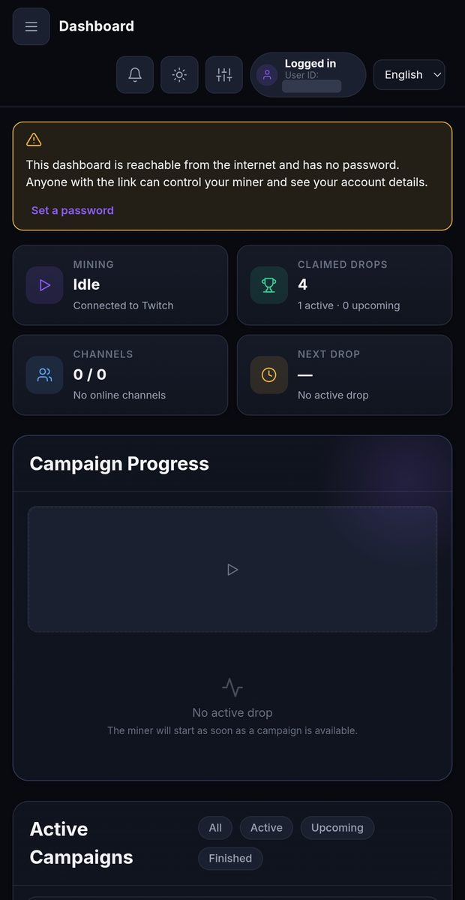
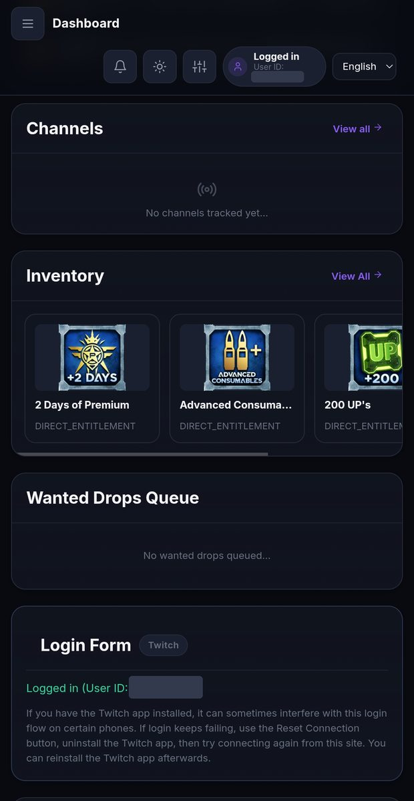
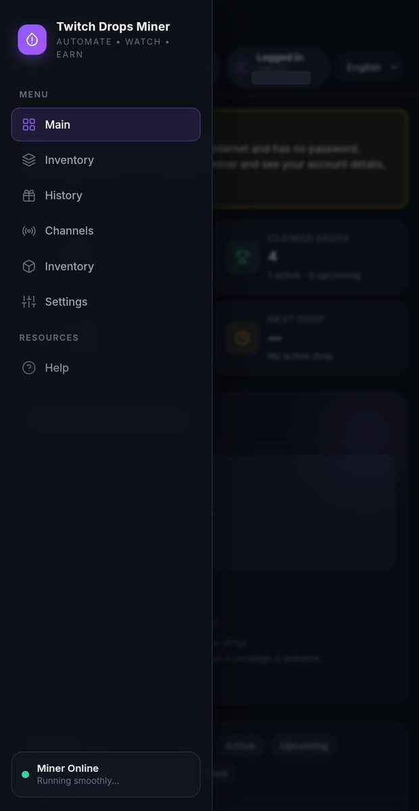
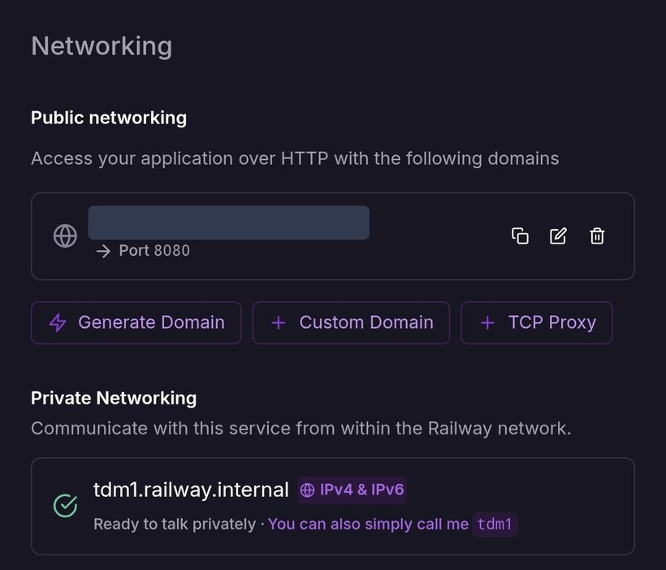
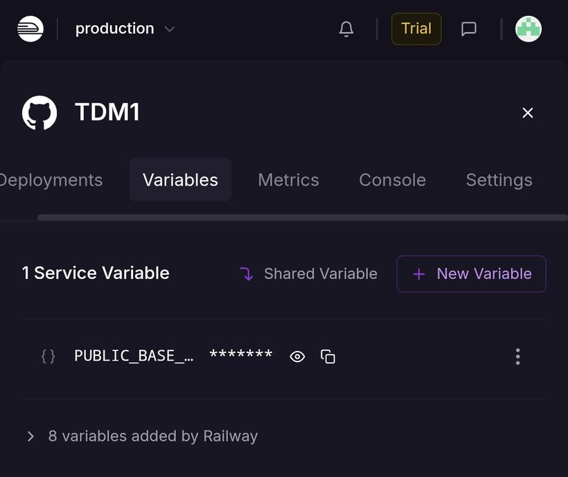

# Twitch Drops Miner

**English** · [فارسی](./README.fa.md)

> Automatically mine timed Twitch Drops without streaming video or audio.


A low-bandwidth, headless Twitch Drops miner: it finds eligible campaigns, picks a
live channel, and tracks drop progress from a web dashboard — without downloading
the stream.

<table>
  <tr>
    <td align="center"><br><sub>Overview &amp; live progress</sub></td>
    <td align="center"><br><sub>Channels, inventory &amp; login</sub></td>
    <td align="center"><br><sub>Navigation menu</sub></td>
  </tr>
</table>

## Features

- Low-bandwidth mining — no video/audio downloads
- Automatic campaign discovery and smart channel selection
- Web dashboard: campaigns, channels, inventory, settings, history
- English and Persian (فارسی) interface, including a full right-to-left layout
- Light and dark theme
- Optional dashboard password (protects UI, API and live connections), with a warning
  banner while the dashboard is public and unprotected
- **Reset Connection** button to get a fresh Twitch login code when a login gets stuck
- Drop history with stats and CSV export
- Telegram notifications on every claimed drop
- Persistent Twitch login sessions
- Docker / headless deployment, ready for Railway

## Quick start

### Docker Compose

```bash
git clone https://github.com/mosikh98/TDM
cd TDM
docker compose up -d --build
```

### From source

Requires Python 3.12+ and [`uv`](https://docs.astral.sh/uv/):

```bash
uv sync
uv run main.py
```

Open <http://localhost:8080> and log in with Twitch.

## Deploy on Railway

The repository contains a `Dockerfile`, so [Railway](https://railway.com) can build and run
it directly from GitHub. Total time: a few minutes.

1. **Create the service.** In Railway choose **New Project → Deploy from GitHub repo** and
   select this repository. Railway builds the included `Dockerfile` and redeploys
   automatically on every push to the connected branch.
2. **Generate a domain.** Open the service → **Settings → Networking → Generate Domain**.
   If Railway asks for the port, enter **`8080`** — that is the port the dashboard listens on.

   

3. **Copy the generated domain**, for example `your-app-production.up.railway.app`, and put
   `https://` in front of it: `https://your-app-production.up.railway.app`.
4. **Add it as a variable.** Open the service → **Variables → New Variable**, name it
   **`PUBLIC_BASE_URL`** and paste the `https://…` address from step 3. Railway redeploys
   by itself.

   

5. **Open the address, log in with Twitch** (the dashboard shows a short code to enter at
   `twitch.tv/activate`), then add your games under **Games to Watch**.
6. **Set a dashboard password right away** (**Settings → Dashboard password**). A Railway
   domain is reachable by anyone on the internet; until you set a password, anyone who
   knows the link can control your miner. The dashboard shows a warning banner until you do.
7. **Recommended — keep your data across deploys.** Railway's container filesystem is wiped
   on every redeploy. Add a **Volume** to the service and mount it at **`/app/data`** so
   your Twitch login, settings and dashboard password survive.

> [!NOTE]
> `PUBLIC_BASE_URL` tells the dashboard its real public HTTPS address, so login cookies are
> marked `Secure` and browser requests are checked against it. Use the **root** URL only —
> no path and no extra text; an invalid value stops the app from starting, with a message
> that starts with `PUBLIC_BASE_URL must be…`. If the variable is missing, the app falls back
> to the domain Railway injects automatically (`RAILWAY_PUBLIC_DOMAIN`), but setting it
> explicitly is recommended.

## Usage

1. Log in via the Smart TV device flow (`twitch.tv/activate`) — the session is saved.
2. Wait for campaigns to load, then add your games in **Games to Watch**
   (priority `1` = highest).
3. Leave it running — channel selection and progress tracking are automatic.

> [!WARNING]
> Don't watch Twitch on the same account while the miner runs — it can desync drop progress.
> Your Twitch account must be linked to your game accounts:
> [twitch.tv/drops/campaigns](https://www.twitch.tv/drops/campaigns)

> [!TIP]
> On some phones the installed Twitch app interferes with the login. If login keeps
> failing, press **Reset Connection**, uninstall the Twitch app, connect again from the
> dashboard, and reinstall the Twitch app afterwards.

## Updates and the “Update Available” notice

The footer compares the version in [`src/version.py`](./src/version.py) with the **latest
GitHub Release of this repository** ([`mosikh98/TDM`](https://github.com/mosikh98/TDM)). If a
newer release exists, the dashboard shows **Update Available** with a link to it. A
repository without any release simply shows no notice.

To publish a new version:

1. Raise the version in `src/version.py` and `pyproject.toml`, then run `uv lock` — the three
   must match (a test enforces it).
2. Push to GitHub (Railway redeploys automatically).
3. On GitHub: **Releases → Draft a new release**, tag it `v1.0.1` (the new version), publish.

The repository is set in one place, `GITHUB_REPO` in
[`src/config/constants.py`](./src/config/constants.py); it also drives the footer and Help
page links. Change it there if you rename or move the repository.

## Telegram notifications

**Settings → Telegram Notifications** → bot token from [@BotFather](https://t.me/BotFather)
+ your chat ID → **Test Connection**.

## Dashboard password

**Settings → Dashboard password** (8–1024 characters). Forgot it? Stop the miner,
delete `data/web_auth.json`, restart, and set a new one.

## Data & logs

- Docker persists data in `./data` (mounted at `/app/data`)
- Source installs keep data in `./data`
- Logs: mount `./logs:/app/logs`
- On Railway, attach a Volume at `/app/data` (see [Deploy on Railway](#deploy-on-railway))

## Contributing

See [CONTRIBUTING.md](./CONTRIBUTING.md). Coding agents must follow [AGENTS.md](./AGENTS.md).

## License

MIT — see [LICENSE](./LICENSE).

## Credits

This project is a fork and would not exist without the people before it:

- **[DevilXD/TwitchDropsMiner](https://github.com/DevilXD/TwitchDropsMiner)** — the original
  Twitch Drops Miner and its author [@DevilXD](https://github.com/DevilXD) (MIT license).
- **[rangermix/TwitchDropsMiner](https://github.com/rangermix/TwitchDropsMiner)** — the
  web-dashboard fork this repository is derived from.

Big thanks to the original authors and to all contributors and translators.
